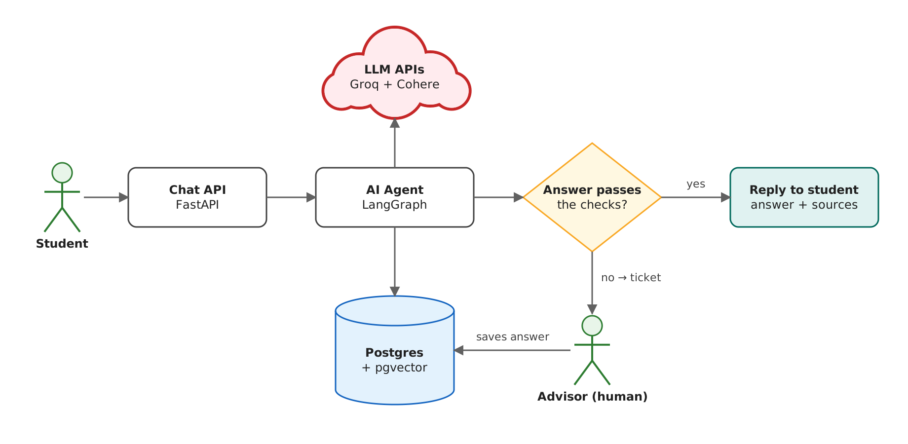

# Governance Pack: Customer Support Agent

**System:** an AI agent that answers students' questions from the institute's CS and IS handbooks. If it is not sure of an answer, it sends the question to a human advisor instead of guessing.

## 1. Architecture Principles

| # | Principle | Business goal |
|---|-----------|---------------|
| P1 | If the AI is not sure, a human answers. | Students can trust the answers. |
| P2 | Protect student personal data. | Follow Egypt's data protection law (PDPL). |
| P3 | Keep running costs low. | The institute can afford to run it. |

## 2. Architecture Decision Records

### ADR-1: API LLM vs self-hosted LLM
- **Options:** Groq and Cohere APIs, or our own model on a GPU (vLLM).
- **Trade-offs:** APIs are cheap and fast to start, but student text leaves Egypt. Self-hosted keeps data inside, but needs a GPU and more work.
- **Decision:** Use APIs for now. Move to self-hosted if privacy rules require it. *(P3)*

### ADR-2: Vector database
- **Options:** pgvector (inside Postgres) or Qdrant (separate service).
- **Trade-offs:** pgvector means one database for everything, which is simpler and cheaper. Qdrant is faster for very large data, but adds another service to run.
- **Decision:** pgvector. Our data is small (two handbooks). *(P3)*

### ADR-3: Real-time vs batch
- **Options:** Do everything while the student waits, or split the work.
- **Trade-offs:** Waiting for an advisor inside the request can take hours and breaks if the server restarts. Splitting adds a ticket system but stays reliable.
- **Decision:** Answer in real time. Escalated questions become tickets that advisors answer later. Evaluation runs as a batch job. *(P1)*

## 3. ARB Checklist

| Area | Check | Status |
|------|-------|--------|
| Security | API keys are stored in `.env`, not in the code | ✅ |
| Security | Users must log in before using the system | ❌ To do |
| Privacy (PDPL) | Phone numbers, emails and national IDs are hidden from answers and logs | ✅ |
| Privacy (PDPL) | A student can delete their data | ⚠️ Partly |
| Evals | A test set of 62 questions measures answer quality | ✅ |
| Evals | Each answer is checked before it is sent | ✅ |
| Cost | Cheap checks run first; smaller models do the easy jobs | ✅ |
| Human oversight | Unsure answers go to a human advisor | ✅ |
| Human oversight | Only an advisor can add new answers to the knowledge base | ✅ |
